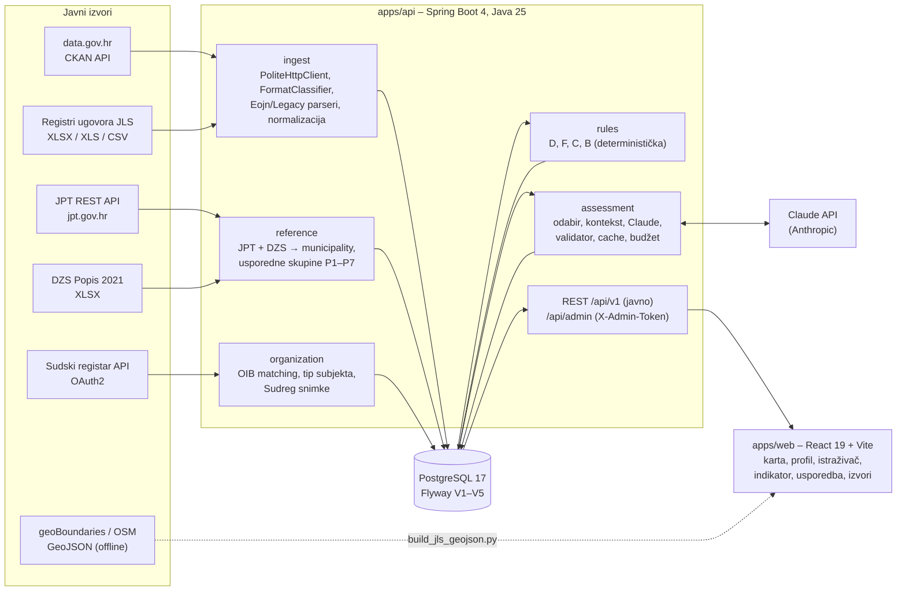

# JavniRadar – tehnička arhitektura

_Tim Nazor · Datathon Portala otvorenih podataka 2026 · izazov A. Stanje koda: grana `main` (PR #55), provjereno 2026-11-08._

Ovaj dokument opisuje **ono što je implementirano**. Plan i šire obrazloženje su u [`docs/ARCHITECTURE.md`](docs/ARCHITECTURE.md), podatkovni model u [`docs/DATA_MODEL.md`](docs/DATA_MODEL.md), a pravila i AI procjena u [`docs/ANOMALY_DETECTION.md`](docs/ANOMALY_DETECTION.md).

## 1. Dijagram

## 2. Moduli

| Modul | Paket / mapa | Odgovornost |
|---|---|---|
| Ingest | `apps/api/.../ingest` (`IngestService`, `FormatClassifier`, `eojn/EojnRegisterParser`, `eojn/LegacyRegisterParser`, `normalize/*`, `http/*`) | otkrivanje skupova preko CKAN-a, pristojan download (robots.txt, 1 zahtjev/s po hostu, retry, disk cache, sha256), klasifikacija formata (A, A2, B, C, D), parsiranje, normalizacija iznosa, datuma, OIB-a, CPV-a i valute (HRK → EUR po 7,53450), deduplikacija |
| Referentni podaci | `reference` (`JptImporter`, `DzsCensusReader`, `MunicipalityImporter`, `PeerGroups`) | 4.678 javnopravnih tijela, 556 JLS sa stanovništvom, usporedne skupine po veličini |
| Organizacije | `organization` (`OrganizationResolver`, `OrganizationClassifier`, `CompanyRegisterService`) | jedinstveni naručitelji i dobavljači po OIB-u, tip (`jls`, `doo`, `obrt`, `fizicka_osoba`…), Sudreg snimke |
| Pravila | `rules` (`ValueIncreaseRule`, `OverpaymentRule`, `SplittingRule`, `ConcentrationRule`, `YoungCompanyRule`, `RulesService`) | deterministički indikatori s verzijom, pragovima iz `config/thresholds.yaml` i dokazima |
| AI procjena | `assessment` (`AiCandidateSelector`, `AiContextBuilder`, `AiRunService`, `AiAssessmentValidator`) + `integration/anthropic` | procjena ugovora uz pravila, nikad spojena s njima |
| Integracije | `integration/ckan`, `integration/jpt`, `integration/sudreg`, `integration/anthropic` | klijenti vanjskih API-ja; bez ključa se uključuju `Noop*` inačice |
| Izvori | `source` | pokrivenost, status datoteka, problemi ingesta |
| Općine | `municipality` | karta (556 JLS) i usporedba sa skupinom |
| Jezik | `wording` + `resources/wording/forbidden_terms_hr.txt` | popis zabranjenih riječi; test ga provjerava |
| Web | `apps/web/src` (`pages/*`, `api/*`, `components/*`) | 8 stranica: početna, istraživač ugovora, detalj ugovora, profil naručitelja, detalj indikatora, izvori, karta, usporedba |

## 3. Tok podataka

1. **Otkrivanje:** `CkanClient` zove `package_search?q=registar ugovora&rows=1000`. Spremaju se skup, izdavatelj, licenca i `metadata_modified` (`source_dataset`).
2. **Download:** `PoliteHttpClient` preuzima XLSX/XLS/CSV resurse i bilježi URL, HTTP status, veličinu, sha256 i vrijeme (`source_file`).
3. **Klasifikacija i parsiranje:** klasa A (33-stupčani EOJN izvoz) i A2 (stari EOJN izvještaj) se parsiraju. B, C i D se evidentiraju kao „format nije podržan” ili „nestrukturirano”.
4. **Provenancija:** svaki izvorni redak ostaje u `raw_record` (JSONB + lokator `sheet;row`). Ugovor pokazuje na `provenance` (metoda, verzija parsera, pouzdanost).
5. **Normalizacija i validacija:** problemi idu u `ingest_issue` (npr. `supplier_oib_invalid_checksum`, `hrk_after_euro`). Redak bez naručitelja, iznosa ili datuma se odbacuje.
6. **Spajanje:** naručitelj i dobavljač po OIB-u → `organization`; naručitelj → JPT (vrsta, županija, osnivači) → DZS (stanovništvo).
7. **Pravila:** `RulesService` računa indikatore nakon ingesta ili na `POST /api/admin/rules/run`.
8. **Sudreg (opcionalno):** `POST /api/admin/sudreg/run` dohvaća snimke dobavljača (samo `doo`, `jdoo`, `dd`, `javno_tijelo`).
9. **AI (opcionalno):** `POST /api/admin/ai/run` procjenjuje odabrane ugovore.
10. **Prikaz:** REST API → React. Demo radi iz baze, nikad uživo s vanjskog izvora.

## 4. Povezivanje izvora (ključevi)

| Spoj | Ključ | Napomena |
|---|---|---|
| Ugovor → naručitelj / dobavljač | **OIB** (11 znamenki, kontrolna znamenka ISO 7064 MOD 11,10, `OibValidator`) | A2: naručitelj iz retka „Naručitelj:” ili izdavatelja na CKAN-u, pa OIB iz JPT-a po jedinstvenom normaliziranom nazivu |
| Naručitelj → JPT | **OIB** | daje vrstu tijela, županiju i **osnivače** |
| Dobavljač → JPT osnivači | **OIB osnivača = OIB naručitelja** | „naručitelj je osnivač dobavljača” (npr. komunalno poduzeće) kao legitiman kontekst za F i C (`JptDirectory.isSupplierFoundedByBuyer`) |
| JPT → DZS | **(normalizirana županija, vrsta, normalizirani naziv JLS)** | DZS nema OIB ni šifru; 556/556 JLS spojeno |
| Dobavljač → Sudski registar | **OIB** | datum osnivanja, NKD, stečaj/likvidacija |
| JLS → granica na karti | **OIB** iz naše tablice `municipality`, dodan u GeoJSON spajanjem po nazivu (skripta) | 542/556 |
| Ugovor → EOJN | `eojn_contract_url` iz izvornog registra | samo poveznica, bez dohvata |
| Ugovor → kategorija | **CPV 2008** (8 znamenki, odjeljak = prve 2) | usporedba i pravila F i C |

**Nova vrijednost iz spajanja:** iznos po stanovniku unutar usporedne skupine (ugovori × DZS), prepoznavanje vlastitih komunalnih društava (ugovori × JPT osnivači), mlada tvrtka i nesklad djelatnosti i predmeta (ugovori × Sudreg NKD).

## 5. AI obrada

- **Model:** `claude-haiku-5-5` (zadano, `AI_MODEL`), effort `medium`, **strukturirani izlaz** prema JSON shemi `resources/ai/ai-flag-v3.schema.json`; prompt `resources/ai/ai-flag-v3.txt`.
- **Kandidati:** ugovori s barem jednim indikatorom pravila, ugovori ≥ 20.000 € ili s generičkim predmetom. **Ne procjenjuju se** obrti, fizičke osobe ni subjekti tipa `ostalo`/`nepoznato` (GDPR).
- **Kontekst:** kanonski JSON (ugovor, indikatori, statistika usporedne skupine kad je n ≥ 8, prag jednostavne nabave, Sudreg podaci s izvorom i datumom). Tekst iz registara ulazi samo kao podatak u JSON poljima.
- **Validator** (`AiAssessmentValidator`), deterministički, nakon svakog poziva: razlog mora citirati polja iz konteksta; zabranjene riječi odbacuju cijeli odgovor; tvrdnja > 300 znakova se odbacuje; „visoka pozornost” s manje od dva razloga postaje „vrijedi provjeriti”; usporedba s općinama bez statistike skupine se odbacuje. Odbačeni odgovori se ne prikazuju.
- **Cache i budžet:** ključ je hash konteksta + model + verzija prompta; `llm_usage` bilježi tokene i trošak; run staje na `AI_MAX_USD_PER_RUN` (zadano 2 USD) i `AI_MAX_CALLS_PER_RUN` (300). Bez `ANTHROPIC_API_KEY` aplikacija i pravila rade normalno.
- **Prikaz:** blok „AI procjena – zahtijeva ljudsku provjeru” na dnu detalja ugovora, s razlozima, citiranim poljima, mogućim legitimnim objašnjenjima i podacima koji nedostaju.
- **Izmjereno** ([`docs/EVALUATION.md`](docs/EVALUATION.md)): sintetika 40 slučajeva, `ai-flag-v3`, dva runa: preciznost 1,00, odziv 0,905 i 0,952, 0 lažno pozitivnih. Na stvarnom uzorku (60) **nema ručnih oznaka**, pa preciznost na stvarnim podacima nije izmjerena. U lokalnoj bazi: 300 prihvaćenih procjena (280 stvarnih, 20 sintetičkih), ukupni trošak svih poziva 0,73 USD (609 zapisa u `llm_usage`).

## 6. REST API

Sve rute su iz `@*Mapping` anotacija u `apps/api/src/main/java`. JSON, camelCase. Liste vraćaju `{content, totalElements, page, size}`. Greške: `{statusCode, message, error}`.

**Javno (`/api/v1`, samo čitanje):**

| Metoda | Ruta | Opis |
|---|---|---|
| GET | `/api/v1/contracts?buyerOib=&supplierOib=&year=&hasIndicator=&severity=&ruleCode=&band=&synthetic=&sort=&page=&size=` | istraživač ugovora |
| GET | `/api/v1/contracts/summary` (isti filtri) | brojke za traku istraživača |
| GET | `/api/v1/contracts/{id}` | ugovor, indikatori (tri dimenzije), provenancija, AI procjena ili razlog zašto je nema |
| GET | `/api/v1/indicators?ruleCode=&buyerOib=&band=&severity=&synthetic=&page=&size=` | popis indikatora |
| GET | `/api/v1/indicators/{id}` | detalj indikatora s dokazima i „što ovo NE znači” |
| GET | `/api/v1/buyers?synthetic=` | naručitelji |
| GET | `/api/v1/buyers/{oib}` | profil naručitelja: po godini, po CPV-u, glavni dobavljači (bez obrta), indikatori, izvori, JPT, DZS |
| GET | `/api/v1/municipalities` | svih 556 JLS za kartu |
| GET | `/api/v1/municipalities/{oib}/peers?year=&cpv2=` | usporedba sa skupinom (medijan, rang, n, `sufficient` za n ≥ 8) |
| GET | `/api/v1/sources?synthetic=&page=&size=` | skupovi i datoteke sa statusom |
| GET | `/api/v1/sources/summary` | pokrivenost i problemi ingesta |

**Administracija (`/api/admin`, header `X-Admin-Token` = env `ADMIN_TOKEN`; bez njega svaki poziv vraća 401):**

| Metoda | Ruta | Opis |
|---|---|---|
| POST | `/api/admin/ingest/run` | ingest registara, JPT-a i DZS-a, zatim pravila |
| POST | `/api/admin/rules/run` | ponovni izračun pravila |
| POST | `/api/admin/synthetic/load` | učitavanje sintetičkog demo skupa |
| POST | `/api/admin/sudreg/run?limit=` · GET `/api/admin/sudreg/status` | dohvat Sudskog registra u pozadini |
| POST | `/api/admin/ai/run?limit=&synthetic=&dryRun=&contractIds=` | AI procjena (`dryRun=true` je zadano i ne zove model) |
| POST | `/api/admin/ai/eval/synthetic` · GET `/api/admin/ai/eval/real-sample` · POST `/api/admin/ai/eval/real-sample/run` · POST `/api/admin/ai/eval/real` | evaluacija AI-ja |

## 7. Standardi i interoperabilnost

| Standard | Gdje se koristi | Stanje |
|---|---|---|
| **OIB** (ISO 7064 MOD 11,10) | ključ svih spajanja, `OibValidator` | ✅ |
| **CPV 2008** (Uredba (EZ) 213/2008) | kategorije ugovora, pravila F i C, usporedba | ✅ |
| **NKD 2007/2025** | djelatnost dobavljača iz Sudskog registra | ✅ (oba oblika) |
| **JSON Schema** | shema izlaza AI procjene (`ai-flag-v3.schema.json`), strukturirani izlaz modela | ✅ |
| **CKAN Action API** | otkrivanje skupova na data.gov.hr | ✅ |
| **OAuth2 client credentials** | Sudski registar | ✅ |
| **GeoJSON** | granice JLS | ✅ |
| REST + JSON | `/api/v1` | ✅ |
| **OpenAPI** specifikacija našeg API-ja | – | ❌ ne postoji; API je opisan u ovom dokumentu (vidi §11) |
| OCDS, DCAT-AP | mapiranje je opisano u `docs/ARCHITECTURE.md` §10 | ❌ nije implementirano |

## 8. Kvaliteta i testovi

- **Backend:** `./mvnw test` → **88 testova, 0 grešaka** (2026-11-08). Integracijski testovi rade nad pravim PostgreSQL 17 kroz Testcontainers (zato treba Docker). Pokrivaju: parsere EOJN i A2 na stvarnoj datoteci Grada Osijeka, normalizaciju, pravila B i D, sintetički ground truth za sva pravila (`SyntheticGroundTruthTest`), privatnost (fizičke osobe i obrti, `ContractPrivacyTest`), validator AI-ja (15 slučajeva), kontekst i run s fixture klijentom (bez ključa), kontrolere, zabranjene riječi (`ForbiddenWordingTest`).
- **Frontend:** `yarn build` (TypeScript + Vite) i `yarn lint` (ESLint) prolaze; `yarn test` → 11/11 (`tests/ui-data.test.mjs`).
- **Točnost parsera:** 20 ugovora klase A i 20 klase A2 ručno uspoređeno s izvornim ćelijama neovisnim čitačem (openpyxl): svih 40 se podudara ([`docs/DATA_SOURCES.md`](docs/DATA_SOURCES.md) §1.1a, §1.1b).
- **Shema baze:** Flyway migracije `V1__init.sql` … `V5__company_snapshot.sql`; Hibernate samo provjerava (`ddl-auto: validate`).
- **Tajne:** samo env varijable (`DB_PASSWORD`, `ADMIN_TOKEN`, `ANTHROPIC_API_KEY`, `SUDREG_CLIENT_ID`, `SUDREG_CLIENT_SECRET`); `apps/api/.env` je u `.gitignore`. Pregled povijesti gita (2026-11-08) nije našao ključeve.

## 9. Preduvjeti za uvođenje

### 9.1 Tehnički

| Preduvjet | Stanje |
|---|---|
| Java 25, Node 22, Yarn 1, Docker (PostgreSQL 17) | lokalno provjereno |
| Server za API i bazu (1 VM, ~2 GB RAM dovoljno za < 10.000 ugovora [PRETPOSTAVKA]) + statički hosting za web | ❌ nije postavljeno; nema javnog demo URL-a |
| Reverse proxy koji poslužuje `web` i prosljeđuje `/api` | u razvoju to radi Vite proxy (`vite.config.ts`); za produkciju treba Nginx ili Spring static |
| Periodični ingest (noćni `@Scheduled` ili cron koji zove admin rutu) | ❌ samo ručno |
| Ključevi: Sudreg (OAuth2), Anthropic (s limitom potrošnje) | opcionalno; bez njih nema pravila B ni AI procjene |
| HTTPS, CORS samo za domenu frontenda, rate limit | ❌ nije implementirano |

### 9.2 Organizacijski

- **Vlasnik sustava:** tko održava ingest i odgovara na prigovore (u MVP-u tim; dugoročno udruga, fakultet ili MPUDT).
- **Postupak ispravka i prava na odgovor** za općine i tvrtke koje se prepoznaju u indikatoru (u MVP-u nije implementiran obrazac; zahtjev ide e-mailom timu).
- **Suradnja s izdavateljima:** JLS koje objavljuju vlastite tablice (klase B, C, D) trebaju prijeći na standardni EOJN izvoz, ili treba poseban parser po izdavatelju.
- **Proračun za LLM:** procjena svih ~2.200 prihvatljivih stvarnih ugovora ≈ 3 USD s Haikuom (mjereno, `log.md` 2026-11-03).

### 9.3 Pravni

| Područje | Preduvjet | Kako ga ispunjavamo / što nedostaje |
|---|---|---|
| Ponovna uporaba podataka | ZPPI i Pravilnik NN 67/17: navođenje izvora | izvor, datoteka i redak uz svaki ugovor; stranica „Izvori”; `DATA_SOURCES.md`. ⚠️ Dva skupa imaju nejasnu licencu na portalu (Grad Bjelovar, Grad Zlatar) |
| GDPR | registri sadrže fizičke osobe i obrte (ime vlasnika u nazivu) | ugovori s fizičkim osobama se ne prikazuju (109 skrivenih); obrt je „Obrt (naziv skriven)” i ne ulazi u top liste ni AI procjenu; nazivi tipa `ostalo` skriveni. ⚠️ Pravna osnova (javni interes) **nije pravno provjerena**; za produkciju treba DPIA |
| Odgovornost za oznake | netočna oznaka može naštetiti ugledu | neutralni jezik (zabranjene riječi su test); „što ovo NE znači” uz svaki indikator; tri odvojene dimenzije umjesto jednog „rizika”; AI uvijek označen kao procjena koja traži ljudsku provjeru |
| Sudski registar | uvjeti korištenja API-ja | ključ dobiven; ⚠️ uvjete ponovne objave podataka treba pročitati i zapisati |
| EOJN | `robots.txt: Disallow: /` | ne strugamo; koristimo samo poveznice iz registara |
| Karta | CC BY-SA 2.0 / ODbL | atribucija ispod karte; izvedena datoteka pod istim uvjetima |
| AI | EU AI Act: sustav ne donosi odluke o osobama; transparentnost | AI samo predlaže što provjeriti, uz oznaku i dokaze; ne obrađuje fizičke osobe ni obrte |
| Licenca koda | OSS | MIT (`LICENSE`), ovisnosti u `THIRD_PARTY_LICENSES.md` |

## 10. Ograničenja

- **Pokrivenost:** 34 od 556 JLS (6 %) ima ugovore u bazi. Na data.gov.hr samo ~61 JLS objavljuje strojno čitljiv registar; od toga parsiramo samo standardne EOJN formate (A, A2).
- **Nema broja ponuda** ni u jednom provjerenom strojno čitljivom izvoru, pa scenarij „niska konkurencija” nije moguć.
- **Usporedba općina:** skupina rijetko ima n ≥ 8, pa usporedba često prikazuje „Nedovoljno podataka”.
- **Kvaliteta izvora:** greške u izvornim registrima prenose se vjerno (npr. iznos s PDV-om manji od iznosa bez PDV-a); označene su kao kvaliteta podataka, ne kao nalaz.
- **AI:** preciznost na stvarnim podacima nije izmjerena (nema ručnih oznaka); sintetički skup je malen (n = 40).
- **Pravilo B** na stvarnim podacima daje 0 indikatora (31 mlada tvrtka, svi ugovori < 50.000 €); vidi se samo na sintetičkom primjeru.
- **Nema deploya**, autentikacije korisnika, obrasca za ispravak ni OpenAPI specifikacije.

## 11. Daljnji razvoj (tehnički)

1. OpenAPI 3 specifikacija (`springdoc-openapi`) i javni API za novinare.
2. Deploy (Docker Compose s API-jem, bazom i Nginxom) i noćni ingest.
3. Parseri za klase B i C (vlastite tablice) i LLM ekstrakcija za D/PDF, s provenancijom `method = LLM`.
4. Izravan EOJN feed (OCDS s OIB-om i brojem ponuda), kad ga MPUDT/EOJN objavi; mapiranje je već opisano u `docs/ARCHITECTURE.md` §10.
5. Izvoz normaliziranog skupa natrag na data.gov.hr (CSV/JSON s DCAT-AP HR metapodacima).
6. Obrazac za ispravak i pravo na odgovor, s moderacijom.
