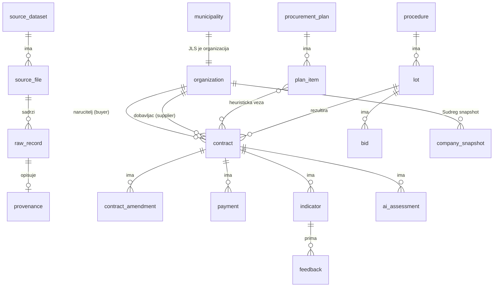

# JavniRadar – podatkovni model (PostgreSQL 17)

_Načelo: **svaki redak zna odakle je došao.** Tablice domene imaju `provenance_id`. Izvorni redak (`raw_record`) se nikad ne briše._

## 1. Pregled entiteta



## 2. SQL skica

```sql
CREATE EXTENSION IF NOT EXISTS pg_trgm;

-- ===== Provenance =====
CREATE TABLE source_dataset (
  id            BIGSERIAL PRIMARY KEY,
  portal        TEXT NOT NULL,               -- 'data.gov.hr' | 'ocp' | 'jpt' | 'dzs' | 'sudreg'
  external_id   TEXT NOT NULL,               -- CKAN package name/uuid
  title         TEXT,
  publisher     TEXT,
  license_id    TEXT,                        -- 'open-license', 'cc-by', ...
  landing_url   TEXT,
  UNIQUE (portal, external_id)
);

CREATE TABLE source_file (
  id              BIGSERIAL PRIMARY KEY,
  dataset_id      BIGINT REFERENCES source_dataset(id),
  url             TEXT NOT NULL,
  format          TEXT,                      -- XLSX/CSV/JSON/PDF
  format_class    CHAR(1),                   -- A/B/C/D (vidi DATA_SOURCES §1.1)
  sha256          CHAR(64),
  bytes           BIGINT,
  http_status     INT,
  retrieved_at    TIMESTAMPTZ NOT NULL,
  ingest_run_id   BIGINT
);

CREATE TABLE raw_record (
  id              BIGSERIAL PRIMARY KEY,
  file_id         BIGINT NOT NULL REFERENCES source_file(id),
  locator         TEXT NOT NULL,             -- 'sheet=1;row=41' | 'page=3' | 'jsonl_line=1200'
  payload         JSONB NOT NULL,            -- izvorni redak, nepromijenjen
  UNIQUE (file_id, locator)
);

CREATE TABLE provenance (
  id                 BIGSERIAL PRIMARY KEY,
  raw_record_id      BIGINT REFERENCES raw_record(id),
  extraction_method  TEXT NOT NULL CHECK (extraction_method IN ('parser','llm','manual','api')),
  extractor_version  TEXT NOT NULL,           -- 'eojn-xlsx-v1', 'llm-extract-v1/claude-haiku-5-5'
  confidence         NUMERIC(3,2) NOT NULL DEFAULT 1.0,
  field_confidence   JSONB,                   -- {"value_eur":0.92,"supplier_oib":0.6}
  created_at         TIMESTAMPTZ NOT NULL DEFAULT now()
);

-- ===== Referentni podaci =====
CREATE TABLE organization (
  id              BIGSERIAL PRIMARY KEY,
  oib             CHAR(11) UNIQUE,            -- NULL samo kad OIB nije poznat
  name            TEXT NOT NULL,
  name_norm       TEXT NOT NULL,              -- vidi §4
  org_type        TEXT NOT NULL CHECK (org_type IN
                    ('jls','zupanija','javno_tijelo','doo','jdoo','dd','obrt','udruga','fizicka_osoba','strana','ostalo','nepoznato')),
  jpt_code        TEXT,                       -- brojčana oznaka iz JPT-a
  jpt_type        TEXT,                       -- VrstaJPT
  founders        JSONB,                      -- JPT Osnivaci [{oib,naziv}]
  county          TEXT,
  is_synthetic    BOOLEAN NOT NULL DEFAULT false,
  provenance_id   BIGINT REFERENCES provenance(id)
);
CREATE INDEX organization_name_trgm ON organization USING gin (name_norm gin_trgm_ops);

CREATE TABLE municipality (
  organization_id BIGINT PRIMARY KEY REFERENCES organization(id),
  kind            TEXT NOT NULL CHECK (kind IN ('grad','opcina','grad_zagreb')),
  county          TEXT NOT NULL,
  population_2021 INT,                        -- DZS
  peer_group      TEXT,                       -- P1..P7 (ANOMALY_DETECTION §3A)
  has_contract_data BOOLEAN NOT NULL DEFAULT false,
  data_coverage_from DATE, data_coverage_to DATE
);

CREATE TABLE company_snapshot (               -- Sudreg, nikad se ne prepisuje
  id              BIGSERIAL PRIMARY KEY,
  organization_id BIGINT NOT NULL REFERENCES organization(id),
  source          TEXT NOT NULL CHECK (source IN ('sudreg','fixture')),
  retrieved_at    TIMESTAMPTZ NOT NULL,
  mbs             TEXT,
  founded_on      DATE,
  dissolved_on    DATE,
  legal_form      TEXT,
  main_nkd        TEXT,
  in_bankruptcy   BOOLEAN,
  payload         JSONB
);

-- ===== Nabava =====
CREATE TABLE procurement_plan (
  id BIGSERIAL PRIMARY KEY, buyer_id BIGINT REFERENCES organization(id), year INT, version TEXT,
  provenance_id BIGINT REFERENCES provenance(id));

CREATE TABLE plan_item (
  id BIGSERIAL PRIMARY KEY, plan_id BIGINT REFERENCES procurement_plan(id),
  evid_number TEXT, subject TEXT, cpv CHAR(8), estimated_value_eur NUMERIC(14,2),
  procedure_type TEXT, planned_quarter TEXT, provenance_id BIGINT REFERENCES provenance(id));

CREATE TABLE procedure (                      -- postupak (EOJN tender)
  id BIGSERIAL PRIMARY KEY, buyer_id BIGINT REFERENCES organization(id),
  eojn_tender_url TEXT UNIQUE, ocid TEXT, title TEXT, procedure_type TEXT,
  procedure_scope TEXT CHECK (procedure_scope IN ('javna','jednostavna','izuzeto','nepoznato')),
  notice_number TEXT, eu_funded BOOLEAN, provenance_id BIGINT REFERENCES provenance(id));

CREATE TABLE lot (
  id BIGSERIAL PRIMARY KEY, procedure_id BIGINT REFERENCES procedure(id), lot_no TEXT, title TEXT);

CREATE TABLE bid (                            -- prazno u MVP-u: broj ponuda nije dostupan (DATA_SOURCES §0)
  id BIGSERIAL PRIMARY KEY, lot_id BIGINT REFERENCES lot(id), bidder_id BIGINT REFERENCES organization(id),
  value_eur NUMERIC(14,2), provenance_id BIGINT REFERENCES provenance(id));

CREATE TABLE contract (
  id                  BIGSERIAL PRIMARY KEY,
  natural_key         TEXT UNIQUE NOT NULL,   -- vidi §3
  buyer_id            BIGINT NOT NULL REFERENCES organization(id),
  supplier_id         BIGINT REFERENCES organization(id),
  procedure_id        BIGINT REFERENCES procedure(id),
  lot_id              BIGINT REFERENCES lot(id),
  plan_item_id        BIGINT REFERENCES plan_item(id),
  eojn_contract_url   TEXT,
  contract_number     TEXT,
  subject             TEXT NOT NULL,
  subject_type        TEXT CHECK (subject_type IN ('robe','usluge','radovi','ostalo')),
  cpv                 CHAR(8),
  cpv_label           TEXT,
  procedure_type      TEXT,
  is_framework_based  BOOLEAN NOT NULL DEFAULT false,
  date_signed         DATE NOT NULL,
  duration_text       TEXT,
  currency_original   CHAR(3) NOT NULL DEFAULT 'EUR',
  initial_value_eur   NUMERIC(14,2),          -- bez PDV-a
  initial_value_vat_eur NUMERIC(14,2),        -- s PDV-om
  amendments_value_eur NUMERIC(14,2),
  total_value_eur     NUMERIC(14,2),          -- bez PDV-a, s izmjenama
  total_value_vat_eur NUMERIC(14,2),
  paid_eur            NUMERIC(14,2),
  completed_on        DATE,
  payment_note        TEXT,                   -- obrazloženje plaćanja (ulaz za AI)
  status              TEXT,
  eu_funded           BOOLEAN,
  is_synthetic        BOOLEAN NOT NULL DEFAULT false,
  provenance_id       BIGINT NOT NULL REFERENCES provenance(id),
  valid_from          TIMESTAMPTZ NOT NULL DEFAULT now(),
  CHECK (total_value_eur IS NULL OR total_value_eur >= 0)
);
CREATE INDEX contract_buyer_date ON contract (buyer_id, date_signed);
CREATE INDEX contract_supplier ON contract (supplier_id);
CREATE INDEX contract_cpv2 ON contract (substr(cpv,1,2));
CREATE INDEX contract_subject_trgm ON contract USING gin (subject gin_trgm_ops);

CREATE TABLE contract_amendment (
  id BIGSERIAL PRIMARY KEY, contract_id BIGINT REFERENCES contract(id),
  amended_on DATE, delta_value_eur NUMERIC(14,2), reason TEXT, legal_basis TEXT,
  provenance_id BIGINT REFERENCES provenance(id));

CREATE TABLE payment (                        -- MVP: jedan zbirni iznos iz registra; budućnost: isplate po Naputku NN 59/23
  id BIGSERIAL PRIMARY KEY, contract_id BIGINT REFERENCES contract(id),
  paid_on DATE, amount_eur NUMERIC(14,2), is_aggregate BOOLEAN NOT NULL DEFAULT true,
  provenance_id BIGINT REFERENCES provenance(id));

-- ===== Analiza =====
CREATE TABLE indicator (
  id                BIGSERIAL PRIMARY KEY,
  rule_code         TEXT NOT NULL,           -- 'C_CONCENTRATION','D_VALUE_INCREASE','D_OVERPAYMENT','F_SPLITTING','B_YOUNG_COMPANY','G_DECEMBER'
  rule_version      TEXT NOT NULL,           -- 'rules-v1'
  subject_type      TEXT NOT NULL CHECK (subject_type IN ('contract','buyer','supplier','buyer_cpv','group')),
  subject_ref       JSONB NOT NULL,          -- {"contract_ids":[…]} ili {"buyer_oib":…,"cpv2":"45"}
  magnitude_value   NUMERIC,
  magnitude_unit    TEXT,
  magnitude_label   TEXT,
  data_quality      TEXT NOT NULL CHECK (data_quality IN ('niska','srednja','visoka')),
  evidence_strength TEXT NOT NULL CHECK (evidence_strength IN ('slaba','srednja','jaka')),
  severity_note     TEXT CHECK (severity_note IN ('informativno','vrijedi_provjeriti')),
  explanation_hr    TEXT NOT NULL,
  not_meaning_hr    TEXT NOT NULL,
  missing_data      TEXT[],
  evidence          JSONB NOT NULL,          -- [{label,url,locator,field}]
  status            TEXT NOT NULL DEFAULT 'aktivan' CHECK (status IN ('aktivan','osporen','ispravljen','povucen')),
  computed_at       TIMESTAMPTZ NOT NULL DEFAULT now(),
  input_hash        CHAR(64) NOT NULL,
  UNIQUE (rule_code, rule_version, input_hash)
  -- NAMJERNO nema stupca "score"/"risk": tri dimenzije se ne spajaju
);

CREATE TABLE ai_assessment (
  id               BIGSERIAL PRIMARY KEY,
  contract_id      BIGINT REFERENCES contract(id),
  label            TEXT NOT NULL CHECK (label IN ('nema_oznake','vrijedi_provjeriti','visoka_pozornost')),
  reasons          JSONB NOT NULL,          -- [{tvrdnja, polja[], izvori[]}]
  missing_data     JSONB NOT NULL,
  legit_explanations JSONB NOT NULL,
  confidence       TEXT NOT NULL CHECK (confidence IN ('niska','srednja','visoka')),
  model            TEXT NOT NULL,           -- 'claude-haiku-5-5'
  prompt_version   TEXT NOT NULL,           -- 'ai-flag-v1'
  input_hash       CHAR(64) NOT NULL,
  status           TEXT NOT NULL CHECK (status IN ('prihvaceno','odbaceno_validacijom','zamijenjeno')),
  rejection_reason TEXT,
  created_at       TIMESTAMPTZ NOT NULL DEFAULT now(),
  UNIQUE (contract_id, model, prompt_version, input_hash)
);

CREATE TABLE llm_usage (id BIGSERIAL PRIMARY KEY, purpose TEXT, model TEXT, input_tokens INT, output_tokens INT,
  cost_usd NUMERIC(10,4), cache_hit BOOLEAN, created_at TIMESTAMPTZ DEFAULT now());

CREATE TABLE feedback (                     -- ispravci, pravo na odgovor, ocjena AI-ja
  id BIGSERIAL PRIMARY KEY,
  target_type TEXT NOT NULL CHECK (target_type IN ('indicator','ai_assessment','contract','organization')),
  target_id BIGINT NOT NULL,
  kind TEXT NOT NULL CHECK (kind IN ('greska_u_podacima','kontekst','pravo_na_odgovor','korisno','pogresno','uklanjanje_osobnih_podataka')),
  role TEXT CHECK (role IN ('gradanin','novinar','narucitelj','dobavljac','ostalo')),
  text TEXT, contact_email TEXT,            -- e-mail se ne prikazuje javno; brisanje nakon 12 mj.
  moderation TEXT NOT NULL DEFAULT 'novo' CHECK (moderation IN ('novo','objavljeno','odbijeno')),
  created_at TIMESTAMPTZ DEFAULT now());

-- ===== Operativno =====
CREATE TABLE ingest_run (id BIGSERIAL PRIMARY KEY, started_at TIMESTAMPTZ, finished_at TIMESTAMPTZ, status TEXT, stats JSONB);
CREATE TABLE ingest_issue (id BIGSERIAL PRIMARY KEY, run_id BIGINT REFERENCES ingest_run(id), raw_record_id BIGINT,
  severity TEXT CHECK (severity IN ('error','warning')), code TEXT, message TEXT);
```

## 3. Identifikatori i deduplikacija

| Entitet | Ključ | Pravilo |
|---|---|---|
| Organizacija | **OIB** (11 znamenki, valjana kontrolna znamenka ISO 7064 MOD 11,10) | Isti OIB je isti entitet. Naziv se uzima iz JPT-a (javna tijela) ili Sudrega (tvrtke), inače najčešći naziv iz ugovora |
| Organizacija bez OIB-a | `name_norm` + mjesto | fuzzy (`similarity ≥ 0.9`) **samo kao prijedlog**; spaja se tek nakon ručne potvrde ili točnog podudaranja `name_norm` |
| Ugovor (klasa A) | `eojn_contract_url` | isti ugovor se pojavljuje u više datoteka (izmjereno 659 duplikata): zadržava se zapis iz **najnovije** datoteke, a stariji se vežu kao povijest (`valid_from`) |
| Ugovor (ostalo) | `sha256(buyer_oib, contract_number, date_signed, supplier_oib or name_norm, round(total,0))` | |
| Ugovor (OCDS) | `ocid + contracts[].id` | |
| JLS | OIB iz JPT-a (`VrstaJPT` = Općina/Grad) | DZS se spaja po `(norm(county), norm(name))`; nespojeni idu u ručnu tablicu `municipality_name_alias` |

**Normalizacija naziva** (`name_norm`):
```
lower → ukloni dijakritike (č,ć→c, š→s, ž→z, đ→dj) → zamijeni pravne oblike
("d.o.o.", "d. o. o.", "društvo s ograničenom odgovornošću" → "doo"; "j.d.o.o." → "jdoo"; "d.d." → "dd"; "obrt" → "obrt")
→ ukloni interpunkciju i višestruke razmake → ukloni "opcina "/"grad " samo za matching JLS
```

**Tip dobavljača:**
- `doo`/`jdoo`/`dd` iz sufiksa naziva ili Sudrega;
- `obrt` ako naziv sadrži "obrt", "vl." ili "vl. ";
- `fizicka_osoba` ako nema pravnog oblika, a naziv izgleda kao "Ime Prezime" (dvije riječi s velikim početnim slovom, bez ključnih riječi) **ili** ako je vrsta ugovora "ugovor o djelu / najam stana / darovanje";
- `strana` ako OIB nije valjan, a naziv ili država upućuju na inozemstvo.

## 4. Nedostajuće vrijednosti
- Nikad se ne imputiraju iznosi. `NULL` znači "nije objavljeno", što se u UI-ju prikazuje kao "nije objavljeno", ne kao 0.
- Indikator koji treba polje koje je `NULL` se ne računa. Umjesto toga zapis se broji u `missing_data` statistici naručitelja (to je ujedno metrika transparentnosti: "% ugovora bez isplaćenog iznosa").
- `paid_eur = 0` i `NULL` se razlikuju.

## 5. Valute i PDV
- Za ugovore s `date_signed < 2023-01-01` ili s eksplicitnim "kn"/"HRK": `eur = round(hrk / 7.53450, 2)`. Zapisuje se `currency_original = 'HRK'`. Tečaj je fiksni (NN 85/2022, Uredba (EU) 2022/1208) [VERIFICIRANO].
- Sve usporedbe i pravila rade s iznosom **bez PDV-a**, osim D2 (isplaćeno se uspoređuje s iznosom s PDV-om) [PRETPOSTAVKA: isplaćeni iznos uključuje PDV, provjeriti na 20 primjera iz klase A].
- Iznosi "mjesečno" (klasa C/D) se ne množe automatski: `total_value_eur = NULL`, `duration_text` se čuva, a `ingest_issue = 'periodic_amount'`.

## 6. Povijest
- `contract` ima `valid_from`; promjena izvora stvara novu verziju retka (SCD2 preko tablice `contract_history`, Should). U MVP-u je dovoljno čuvati sve `raw_record` zapise i `source_file.sha256`.
- `company_snapshot` je append-only.
- Indikatori se ne brišu: kad se pravilo promijeni, nastaje nova `rule_version`, a stari indikatori dobivaju `status = 'povucen'`.

## 7. Sintetički podaci
- `is_synthetic = true` na organizaciji i ugovoru. OIB-i iz raspona `000000000xx` (namjerno nevaljani). Nazivi "Općina Primjerovo", "Primjer d.o.o.".
- API vraća `"synthetic": true`, a UI prikazuje traku **"SINTETIČKI PODACI ZA DEMONSTRACIJU"**.
- Sintetički i stvarni zapisi **nikad** ne ulaze u istu usporednu skupinu ni statistiku (`WHERE NOT is_synthetic` u svim agregatima, uz test).

## 8. Stanje implementacije (POC, `V1__init.sql`, 2026-11-02)
**Implementirano:** `source_dataset`, `source_file`, `raw_record`, `provenance`, `organization`, `contract`, `indicator`, `ingest_run`, `ingest_issue`.
**Još nije:** `municipality`, `company_snapshot`, `procurement_plan`, `plan_item`, `procedure`, `lot`, `bid`, `contract_amendment`, `payment`, `ai_assessment`, `llm_usage`, `feedback` (dolaze s pravilima F/C, AI-jem i Sudregom). Iznos izmjene i isplaćeni iznos su stupci u `contract`, kao u izvoru klase A.

**Dodaci u odnosu na §2** (obrazloženje u `work/decisions.md`):
| Tablica | Stupac | Zašto |
|---|---|---|
| `source_dataset` | `metadata_modified`, `is_synthetic` | CKAN svježina; sintetički izvor se označava na razini skupa |
| `source_file` | `resource_id`, `name`, `resource_modified`, `error_message`; `UNIQUE (url, sha256)` | `resource_modified` određuje "najnoviju datoteku" kod deduplikacije; ponovni run preskače već uvezenu datoteku |
| `ingest_issue` | `file_id` | greške na razini datoteke nemaju `raw_record` |
| `contract` | `eojn_tender_url`, `framework_agreement_url`, `evid_number`, `note`, `quality_flags TEXT[]` | tablica `procedure` još ne postoji; `quality_flags` su upozorenja normalizacije i ulaz za `data_quality` |
| `contract` | bez `procedure_id`, `lot_id`, `plan_item_id` | povezane tablice još ne postoje |
| `indicator` | `contract_id` | brzi filtar "ima indikator" za pravila nad jednim ugovorom |

**Kodovi u bazi** ostaju hrvatski kao u §2 (`'doo'`, `'robe'`, `'parser'`); Java enumi su engleski (`LLC`, `GOODS`, `PARSER`) i mapiraju se konverterom (`DatabaseCodeConverter`).
**Prikaz osjetljivih dobavljača (GDPR, odluka 2026-11-02):**
- `fizicka_osoba`: ugovor se ne vraća iz API-ja i ne obrađuje se pravilima.
- `obrt`: zapis se čuva u bazi, ali API umjesto naziva vraća `"Obrt (naziv skriven)"` (`supplier.nameHidden = true`), uz OIB i poveznicu na izvor. Obrti se isključuju iz "top" lista i sažetaka. Indikatori ostaju, AI procjene nema.
- Izvorni `raw_record.payload` sadrži izvorni naziv. API ga ne izlaže; prikazuje se samo poveznica na izvornu datoteku.

**Lokator:** `sheet=<1-based indeks lista>;row=<Excel redak>`, `raw_record.payload` = `{zaglavlje: tekst ćelije}` bez praznih ćelija.
